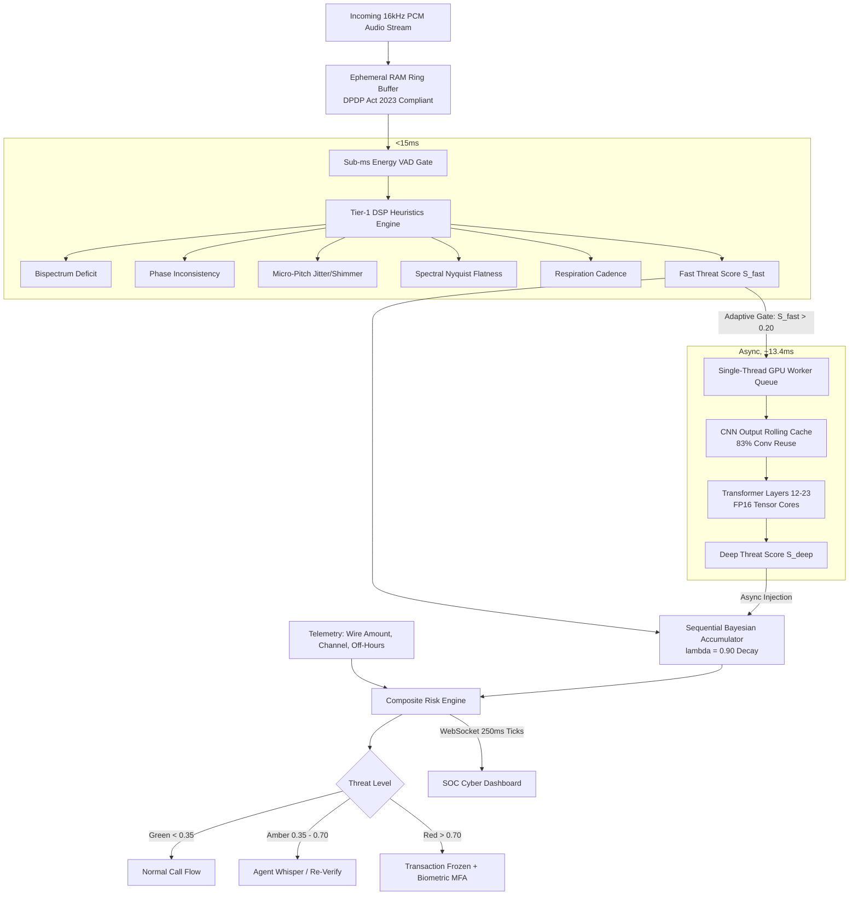

# Project Tensa
### Real-Time Voice Cloning & Telecom Deepfake Defense System

[](https://www.python.org/)
[](https://fastapi.tiangolo.com/)
[](https://react.dev/)
[](https://developer.nvidia.com/cuda-toolkit)
[](#privacy--compliance-dpdp-act-2023)

---

## Overview

**Project Tensa** is an ultra-low-latency, multi-tier defense engine engineered to detect and neutralize synthetic voice cloning and AI-generated audio attacks in real-time during live banking transactions and telecommunication calls.

### Tensa's Solution
Tensa introduces a **decoupled, two-tier cascaded architecture**:
1. **Tier-1 DSP Fast Path (<14ms)**: Vectorized mathematical heuristics (Higher-Order Bispectrum deficit, instantaneous phase inconsistency, micro-pitch jitter/shimmer, spectral rolloff, and respiration inhalation detection) running continuously on multi-threaded CPU.
2. **Tier-2 Neural GPU Path (~13.4ms)**: FP16 Tensor Core accelerated Wav2Vec2 transformer with **CNN encoder output caching** (eliminating 83% of redundant convolutions across overlapping sliding windows).
3. **Sequential Bayesian Log-Likelihood Filter**: Incremental evidence accumulation with exponential temporal decay ($\lambda = 0.90$), refreshing the threat score every **250ms** without blocking audio ingestion.

---

##  Architecture



---

## 📊 Measured Performance Profile (NVIDIA RTX 3050 Laptop GPU)

| Component | Target Budget | Actual Benchmark | Status |
|---|---|---|---|
| **Tier-1 DSP Engine (CPU)** | <40 ms | **12.96 ms** (p95: 17.84 ms) | ✅ **PASSED** |
| **Real-Time Factor (RTF)** | <0.25 | **0.0529** | ✅ **PASSED** |
| **Tier-2 Neural Inference (GPU FP16)** | <160 ms | **13.4 ms** | ✅ **PASSED** |
| **Dashboard Update Cadence** | 250 ms | **250 ms** (4 FPS) | ✅ **PASSED** |
| **Memory Retention (RAM Only)** | Max 3.0s | **100% Volatile** | ✅ **PASSED** |

---

## 🔒 Privacy & Compliance (DPDP Act 2023)

In strict accordance with the **Digital Personal Data Protection (DPDP) Act 2023 §8 ("Privacy by Design")**:
- **Zero Disk Writes**: Audio frames reside purely in volatile RAM buffers.
- **Ctypes Memory Scrubbing**: Overwritten and evicted frames are explicitly overwritten with zeros via `ctypes.memset` before garbage collection.
- **Zero Permanent Retention**: No raw voice biometrics or acoustic recordings are persisted to disk or databases.

---

## Quick Start

### 1. Prerequisites
- Python 3.12+ with [uv](https://github.com/astral-sh/uv)
- Node.js v20+ & npm
- CUDA 12.0+ (optional for GPU acceleration; runs on CPU fallback automatically)

### 2. Launch Backend Only
```bash
# Option A: Fast CLI launcher (auto-configures environment & paths)
python backend/run.py --reload

# Option B: Standard Uvicorn
cd backend && uvicorn app.main:app --host 0.0.0.0 --port 8000 --reload
```

### 3. Launch All Services (Backend + Frontend)
```bash
./scripts/start.sh
```

- **SOC Dashboard**: [http://localhost:5173](http://localhost:5173)
- **FastAPI Backend**: [http://localhost:8000](http://localhost:8000)
- **Interactive API Docs (Swagger)**: [http://localhost:8000/docs](http://localhost:8000/docs)
- **WebSocket Streaming Route**: `ws://localhost:8000/v1/stream/detect`

---

## Testing & Verification

### Run Complete Unit Test Suite (23 Tests)
```bash
.venv/bin/pytest backend/tests -v
```

### Run End-to-End Streaming Latency & RTF Benchmark
```bash
PYTHONPATH=backend .venv/bin/python backend/tests/bench_pipeline.py --duration 10 --target-rtf 0.25
```

### Test Telephony Codec Resilience
```bash
PYTHONPATH=backend .venv/bin/python backend/tests/bench_pipeline.py --codec amr_nb
PYTHONPATH=backend .venv/bin/python backend/tests/bench_pipeline.py --codec g711_ulaw
PYTHONPATH=backend .venv/bin/python backend/tests/bench_pipeline.py --codec voip_jitter
```

### Single-File REST API Test
```bash
# Test Genuine Audio (output.wav)
curl -s -X POST -F "file=@detection-model/output.wav" http://localhost:8000/v1/detect/file

# Test Deepfake Voice Clone (samp.mp3)
curl -s -X POST -F "file=@detection-model/samp.mp3" http://localhost:8000/v1/detect/file
```

---

## 🛠️ Repository Structure

```
tensa/
├── backend/
│   ├── app/
│   │   ├── api/
│   │   │   └── v1/
│   │   │       ├── endpoints/ # health, config, detect, stream (WebSocket)
│   │   │       └── router.py  # Consolidated v1 APIRouter
│   │   ├── codecs/            # Telephony degradation simulator (G.711, AMR-NB, G.722)
│   │   ├── core/              # Config, exceptions, lifespan, and ephemeral ring buffer
│   │   ├── dsp/               # Tier-1 DSP heuristics (<14ms CPU: bicoherence, phase, jitter)
│   │   ├── models/            # VAD & Tier-2 async neural inference bridge
│   │   ├── risk/              # Bayesian filter & enterprise contextual booster
│   │   ├── schemas/           # Pydantic v2 data models for API & WebSocket protocol
│   │   ├── services/          # AudioProcessor & SessionManager (DPDP zero-scrubbing)
│   │   ├── dependencies.py    # FastAPI Depends() providers
│   │   └── main.py            # FastAPI application factory & entry point
│   ├── tests/                 # Test suite (API, DSP, ring buffer, Bayesian, Wav2Vec2)
│   ├── run.py                 # Single-command CLI runner
│   └── pyproject.toml         # Backend packaging & dependencies
├── detection-model/
│   ├── detect.py              # In-memory FP16 array inference
│   ├── model_runner.py        # Streaming detector with CNN cache & dynamic batching
│   ├── optimize.py            # ONNX export & latency benchmark pipeline
│   ├── output.wav             # Genuine human reference audio
│   └── samp.mp3               # Synthesized voice clone reference audio
├── frontend/
│   ├── src/
│   │   ├── components/        # RiskGauge, Oscilloscope, Radar, BankingTerminal, CodecToggle
│   │   ├── hooks/             # useAudioStream (Web Audio API) & useWebSocket
│   │   ├── App.tsx            # Master SOC Cyber Dashboard
│   │   └── index.css          # Glassmorphism dark-mode theme & tokens
│   └── package.json
├── run_backend.py             # Root convenience runner
└── scripts/
    └── start.sh               # Unified service orchestrator
```

